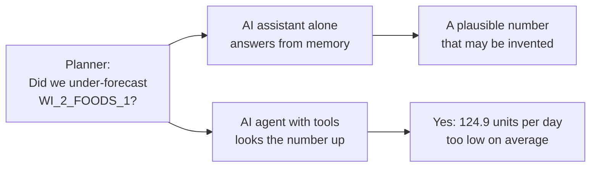
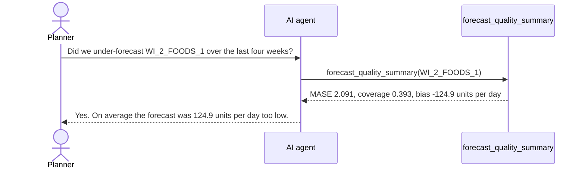
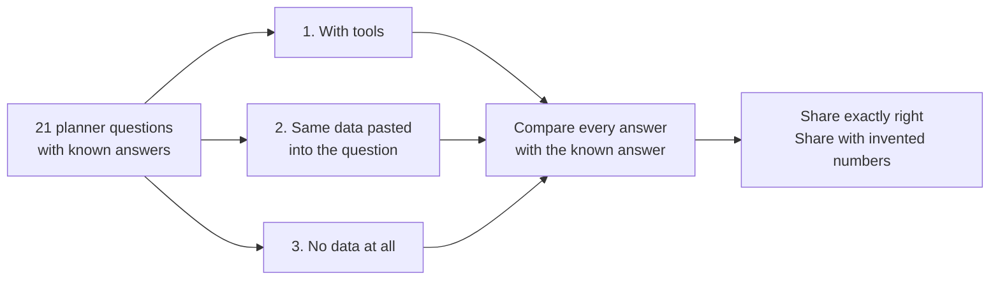

# Forecast-Quality Analysis Agent: an LLM Agent for Supply Chain Planners

[](https://github.com/akrambouznad789-cyber/forecast-quality-agent/actions/workflows/tests.yml)

[](LICENSE)

> **In one minute.** Every week, supply chain planners check which forecasts went wrong. AI assistants like ChatGPT
> can answer such questions in plain English, but they sometimes invent numbers that sound right. This project gives
> an AI assistant a few tools to look up the real numbers, the way a person opens the spreadsheet instead of
> answering from memory, and measures how often its answers are exactly right, compared with the same assistant
> without the tools.

**Status: work in progress** (started October 2026). Done: the agent's tools and 21 test questions with known
answers, both checked by unit tests. Next: the agent itself, then the comparison. Each section below starts in plain
language; click **Technical details** for the method and the code.

---

## 1. The problem: an AI assistant can sound right and be wrong
A planner asks a simple question. An AI assistant answering from memory gives a plausible number, which may be
invented. An AI agent with tools looks the number up in the forecast data first.



<details>
<summary><b>Technical details: research question and hypotheses</b></summary>

**Research question.** Can an LLM agent that calls forecasting tools answer planners' questions about forecast
quality more accurately than the same LLM without tools?

- **H1.** With tools, the agent's numeric answers match the reference far more often than the LLM alone.
- **H2.** With tools, the rate of hallucinated numbers (numbers found in no tool output) drops close to zero.
- **H3.** The remaining errors are mostly tool-selection or argument errors (wrong series, wrong date), which an
  error analysis can classify.

</details>

## 2. How the agent works
The agent has three tools, like three buttons it can press to read the forecast data. It decides which one to use,
reads the result and answers in plain English.

| Tool | What it looks up |
|---|---|
| `get_forecast` | The forecast for one department on one day, its range, and what really sold |
| `forecast_quality_summary` | How accurate the forecasts were for one department, and whether they were too high or too low |
| `rank_series_by_forecast_error` | The departments with the least accurate forecasts |



*The tool output is real (computed from the data). The agent's last sentence shows the target behaviour: building
the agent loop is the next step.*

<details>
<summary><b>Technical details: tools, arguments and outputs</b></summary>

Each tool returns plain JSON-serializable data, so the model reads the numbers instead of guessing them. Code:
[`planning_tools.py`](planning_tools.py).

| Tool | Arguments | Returns |
|---|---|---|
| `get_forecast` | `series_id`, `date` | Point forecast, 80% prediction interval, actual demand, whether the actual fell inside |
| `forecast_quality_summary` | `series_id` | MASE, 80% interval coverage, mean bias in units per day, over- or under-forecast |
| `rank_series_by_forecast_error` | `top_n` | The store-departments with the highest MASE |

Unknown series and dates outside the test window raise an error instead of returning a guess, so the agent sees
its own argument errors.

```python
>>> from planning_tools import get_forecast, forecast_quality_summary
>>> get_forecast("CA_3_FOODS_2", "2016-05-05")
{'series_id': 'CA_3_FOODS_2', 'date': '2016-05-05', 'point_forecast': 529.0, 'interval_80': [340.9, 720.4], 'actual': 738.0, 'actual_inside_interval': False}
>>> forecast_quality_summary("WI_2_FOODS_1")
{'series_id': 'WI_2_FOODS_1', 'mase': 2.091, 'coverage_80': 0.393, 'mean_bias_units_per_day': -124.9, 'direction': 'under-forecast'}
```

A negative bias means the forecast was below actual demand (under-forecasting). MASE is defined in the companion
project's README.

</details>

## 3. How we test it
We wrote 21 questions a planner would ask and computed the exact answer to each from the data. The same AI then
answers every question in three situations, and we count how often it is exactly right and how often it invents a
number.



| Question type | Example | Count |
|---|---|---:|
| Range lookup | "What was the 80% prediction interval for CA_3_FOODS_2 on 2016-05-05, and did actual demand fall inside it?" | 10 |
| Too high or too low? | "Over the last four weeks, did we over-forecast or under-forecast CA_1_FOODS_2, and by how many units per day on average?" | 10 |
| Ranking | "Which five store-departments had the least accurate forecasts over the last four weeks?" | 1 |

Situation 2 gives the AI the same information as the tools, so the comparison measures the tools themselves.
Situation 3 shows whether the AI admits it cannot know, or makes a number up.

<details>
<summary><b>Technical details: evaluation set, protocol and metrics</b></summary>

**Evaluation set.** [`evaluation/questions.jsonl`](evaluation/questions.jsonl): 21 questions, each with a stable
`question_id` and a reference answer computed by the tools (exact lookups). Series and dates are sampled with a
fixed seed (2026); a unit test rebuilds the set from the seed and checks that it matches the committed file. Code:
[`build_evaluation_questions.py`](build_evaluation_questions.py).

```json
{"question_id": "interval_lookup_01", "type": "interval_lookup", "question": "What was the 80% prediction interval for CA_3_FOODS_2 on 2016-05-05, and did actual demand fall inside it?", "reference_answer": {"series_id": "CA_3_FOODS_2", "date": "2016-05-05", "point_forecast": 529.0, "interval_80": [340.9, 720.4], "actual": 738.0, "actual_inside_interval": false}}
```

**Conditions.** The same LLM answers every question (1) with tool calling, (2) without tools but with the same
forecast table in the prompt, and (3) with no data.

**Metrics.** The share of answers within tolerance of the reference; the hallucinated-number rate; and tool-call
accuracy (right tool, right arguments).

**Pre-registration.** The tolerance and scoring rules will be committed to this README before the first agent run,
so they cannot be tuned to the results.

**Error analysis.** Every wrong answer is classified as a wrong tool, wrong arguments, a misread tool output or an
unsupported number.

</details>

## 4. Where the data come from
The forecasts come from the companion project,
[demand-forecasting-benchmark](https://github.com/akrambouznad789-cyber/demand-forecasting-benchmark): real Walmart
sales, 70 store departments, four weeks of forecasts made by a simple method.

<details>
<summary><b>Technical details: data provenance</b></summary>

[`data/`](data) holds `forecasts_seasonal_naive.csv` and `scores_seasonal_naive.csv`: M5 Walmart sales, 70 store ×
department series, 28-day test window (2016-04-25 to 2016-05-22), seasonal naive baseline with empirical 80%
intervals. The files were copied from the benchmark's `results/` folder at commit
[`be56a45`](https://github.com/akrambouznad789-cyber/demand-forecasting-benchmark/tree/be56a4581ee0bf29c67ee0b8fc2ae1ece8d65a7a/results).
When the benchmark adds models, the files will be refreshed and the new commit recorded here.

</details>

## 5. What comes next
- [x] Tools that look up the forecast data, checked by unit tests
- [x] 21 test questions with known answers, reproducible
- [ ] The agent itself (an LLM with tool calling), and the two comparison situations
- [ ] Scoring rules written down before the first run, then scoring and error analysis
- [ ] Harder questions that need several tool calls

---

## For developers

<details>
<summary><b>Reproduce, run the tests, repository structure</b></summary>

Requires Python 3.12 or later.

```bash
git clone https://github.com/akrambouznad789-cyber/forecast-quality-agent.git
cd forecast-quality-agent
python -m venv .venv
source .venv/bin/activate          # Windows: .venv\Scripts\activate
pip install -r requirements.txt
python build_evaluation_questions.py   # rebuilds evaluation/questions.jsonl (identical for seed 2026)
```

**Tests.** `pip install -r requirements-dev.txt`, then `pytest`. The tests check that every tool output is
consistent with the data, that bad arguments fail loudly, and that the evaluation set is reproducible. The agent
will be scored against these tools, so a wrong tool would silently corrupt the evaluation. GitHub Actions runs the
tests on every push.

```
├── planning_tools.py              # the tools the agent can call
├── build_evaluation_questions.py  # builds the reference question set
├── evaluation/questions.jsonl     # 21 questions with reference answers
├── data/                          # forecasts and scores from demand-forecasting-benchmark
└── tests/                         # unit tests (pytest)
```

</details>

## References
- Hyndman, R. J., & Koehler, A. B. (2006). Another look at measures of forecast accuracy. *International Journal of
  Forecasting*, 22(4), 679–688. https://doi.org/10.1016/j.ijforecast.2006.03.001
- Schick, T., et al. (2023). Toolformer: Language models can teach themselves to use tools. *NeurIPS 2023*.
  [arXiv:2302.04761](https://arxiv.org/abs/2302.04761)
- Yao, S., Zhao, J., Yu, D., Du, N., Shafran, I., Narasimhan, K., & Cao, Y. (2023). ReAct: Synergizing reasoning
  and acting in language models. *ICLR 2023*. [arXiv:2210.03629](https://arxiv.org/abs/2210.03629)

## Citation
If this project is useful in your work, please cite it using [CITATION.cff](CITATION.cff) (GitHub's
"Cite this repository" button).

## License
The code is released under the [MIT License](LICENSE). The forecasts in `data/` are derived from the M5 competition
data, which belong to their providers.

## Author
Akram Bouznad, research master's student (M.A.Sc.) in industrial engineering, data science profile, Polytechnique
Montréal · [LinkedIn](https://www.linkedin.com/in/akram-bouznad-68aa7b292/)
